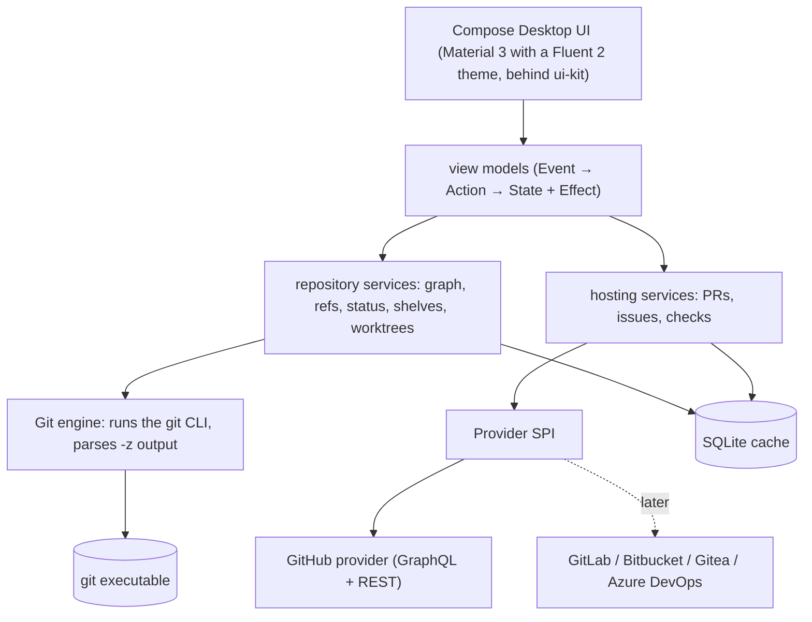

<!-- Generated from the Graft design notes by scripts/sync-design-docs.py. Edit the notes, not this file. -->

# Graft

> [!NOTE]
> **One sentence**
> **Graft** is an open-source desktop Git client: a commit graph like GitKraken's, pull requests and issues next to the code, and JetBrains-style **shelves** and first-class **worktrees** that other Git clients don't have.

> [!NOTE]
> **Name**
> **Graft**, chosen 2026-10-18. Grafting joins a branch from one tree onto another, which is what merge, rebase and cherry-pick do. Availability checks still to do: [Naming](03%20-%20Project/04%20-%20Naming.md).

## The problem

| Tool | Good at | Missing |
|---|---|---|
| GitKraken | graph, PRs, issues, worktrees | closed source, paid for private repos, Electron memory use |
| GitHub Desktop | simple, open source | no graph, no worktrees, almost no stash UI |
| Fork, Sublime Merge, Tower | fast, polished | closed source, weak or no PR/issue integration |
| JetBrains IDEs | shelves, changelists, good diff | only inside an IDE, one project per window |
| `git` CLI | everything | no overview: the graph, worktrees and submodules are hard to see |

No open-source client combines a full graph, hosting integration (PRs, issues), worktrees, submodules **and** shelves.

## What Graft does

| Area | Capabilities | Note |
|---|---|---|
| **Graph** | local and remote branches, tags, stashes, worktree heads and PR badges on one commit graph; search, filter, solo/hide branches | [Commit Graph](02%20-%20Features/01%20-%20Commit%20Graph.md) |
| **Branches and tags** | create, checkout, rename, delete, track; merge, rebase, cherry-pick, revert, reset | [Branches and Tags](02%20-%20Features/02%20-%20Branches%20and%20Tags.md) |
| **Sync** | fetch, pull (merge / rebase / ff-only), push, force-with-lease, multiple remotes | [Sync](02%20-%20Features/03%20-%20Sync.md) |
| **Working copy** | stage by file, hunk or line; commit, amend; diff viewer; conflict resolution | [Working Copy and Commit](02%20-%20Features/04%20-%20Working%20Copy%20and%20Commit.md) |
| **Stash** | push (partial), apply, pop, drop, view as graph nodes | [Stash](02%20-%20Features/05%20-%20Stash.md) |
| **Shelves** | named, independent, partial change sets; unshelve per file; shared across worktrees | [Shelves](02%20-%20Features/06%20-%20Shelves.md) |
| **Worktrees** | list, create, open, lock, remove, prune; see which branch lives where | [Worktrees](02%20-%20Features/07%20-%20Worktrees.md) |
| **Submodules** | status, init, update, sync, add, remove; open a submodule as a nested repo | [Submodules](02%20-%20Features/08%20-%20Submodules.md) |
| **Pull requests** | list, review, comment, create, checkout, merge (GitHub first) | [Pull Requests](02%20-%20Features/09%20-%20Pull%20Requests.md) |
| **Issues** | list, filter, create, comment, start a branch from an issue | [Issues](02%20-%20Features/10%20-%20Issues.md) |
| **Profiles** | several identities (Personal, Work): git name/email, accounts, SSH key, tabs; auto-picked per repo | [Profiles](02%20-%20Features/11%20-%20Profiles.md) |
| **SSH** | generate keys, add to agent and GitHub, verify host keys, test, one key per profile, SSH commit signing | [SSH](02%20-%20Features/12%20-%20SSH.md) |
| **Terminal and AI agents** | Claude Code, Cursor and the terminal commit, push and open PRs as the repo's profile; `graft whoami`, `graft doctor`, `gh` shim | [Terminal and AI Agents](02%20-%20Features/13%20-%20Terminal%20and%20AI%20Agents.md) |
| **Local history** | automatic snapshots of uncommitted work; restore a file or the whole tree from minutes ago | [Local History](02%20-%20Features/14%20-%20Local%20History.md) |
| **Changelists** | JetBrains-style named groups of uncommitted changes; commit or shelve one at a time | [Changelists](02%20-%20Features/15%20-%20Changelists.md) |
| **Reflog and recovery** | reflog timeline, restore branches, find lost commits, banner when a branch is rewritten outside Graft | [Reflog and Recovery](02%20-%20Features/16%20-%20Reflog%20and%20Recovery.md) |
| **Repositories** | home screen, clone/init/scan, tabs, workspaces with bulk fetch/pull, `graft open` | [Repositories and Workspaces](02%20-%20Features/17%20-%20Repositories%20and%20Workspaces.md) |
| **My Work** | PRs to review, my PRs, assigned issues across all repos; GitHub notifications | [My Work and Notifications](02%20-%20Features/18%20-%20My%20Work%20and%20Notifications.md) |
| **Commit guards** | block secrets, keys, `.env`, huge files before commit and push, including agents' commits | [Commit Guards](02%20-%20Features/19%20-%20Commit%20Guards.md) |
| **Ignore and clean** | ignore from the changes panel, `.gitignore` editor, previewed `git clean` | [Ignore and Clean](02%20-%20Features/20%20-%20Ignore%20and%20Clean.md) |
| **Compare** | what's in B not in A, merge preview, compare worktrees | [Compare Branches](02%20-%20Features/21%20-%20Compare%20Branches.md) |
| **Onboarding** | first-run setup: Git, profiles, SSH, GitHub, CLI, AI tools | [Onboarding](02%20-%20Features/22%20-%20Onboarding.md) |
| **Agent worktrees** | launch agents in parallel worktrees, watch them, review hunk by hunk | [Agent Worktrees and Review](02%20-%20Features/23%20-%20Agent%20Worktrees%20and%20Review.md) |
| **CI** | Actions runs, logs, annotations, re-run, workflow dispatch | [CI and Actions](02%20-%20Features/24%20-%20CI%20and%20Actions.md) |
| **Stacks** | stacked branches and PRs, restack with `--update-refs` | [Stacked Branches](02%20-%20Features/25%20-%20Stacked%20Branches.md) |
| **Fixup and absorb** | fixup into a commit, autosquash, automatic absorb | [Fixup and Absorb](02%20-%20Features/26%20-%20Fixup%20and%20Absorb.md) |
| **Bisect** | bisect on the graph, in a temporary worktree, manual or automatic | [Bisect](02%20-%20Features/27%20-%20Bisect.md) |
| **Patches** | create and apply patches and mailbox series | [Patches](02%20-%20Features/28%20-%20Patches.md) |
| **Config editor** | effective git config with origins, aliases, includes, attributes | [Git Config Editor](02%20-%20Features/29%20-%20Git%20Config%20Editor.md) |
| **History rewriting** | change authors, remove files or secrets from history, with backups | [History Rewriting](02%20-%20Features/30%20-%20History%20Rewriting.md) |
| **CLI** | `graft` for you, scripts and agents: shelves, changelists, history, guards, review feedback, stacks; `--json` | [CLI](02%20-%20Features/31%20-%20CLI.md) |
| **MCP server** | `graft mcp`: the same features as tools for Claude Code and Cursor; runs locally, nothing to deploy | [MCP Server](02%20-%20Features/32%20-%20MCP%20Server.md) |

## Shape of the app

- **The `git` executable is the engine.** Graft never reimplements Git. It runs `git` with machine-readable output, so hooks, signing, credential helpers, LFS, worktrees and submodules behave exactly as on the command line ([Git Engine](01%20-%20Foundations/03%20-%20Git%20Engine.md)).
- **Providers are plugins behind one contract.** GitHub is the first. A pull request and a merge request are both a `ChangeRequest` ([Provider Model](01%20-%20Foundations/04%20-%20Provider%20Model.md)).
- **Kotlin + Compose Multiplatform Desktop** ([ADR-1](03%20-%20Project/02%20-%20Decisions.md)), built on Material 3 with a Fluent 2 theme, Ktor and AndroidX ViewModel first, with GitKraken's layout and JetBrains' behavior ([UI Design](01%20-%20Foundations/06%20-%20UI%20Design.md)). Camouflage and Sinew are adopted later, when they're ready, through seams that exist from day one ([ADR-9](03%20-%20Project/02%20-%20Decisions.md)).

## Doc map

**Foundations**
- [Vision and Scope](01%20-%20Foundations/01%20-%20Vision%20and%20Scope.md): goals, non-goals, users, principles.
- [Architecture](01%20-%20Foundations/02%20-%20Architecture.md): stack, modules, layers, threading, storage.
- [Git Engine](01%20-%20Foundations/03%20-%20Git%20Engine.md): how Graft runs and parses `git`.
- [Provider Model](01%20-%20Foundations/04%20-%20Provider%20Model.md): the hosting abstraction, auth, rate limits.
- [Accessibility](01%20-%20Foundations/05%20-%20Accessibility.md): screen readers on the graph, keyboard, contrast.
- [UI Design](01%20-%20Foundations/06%20-%20UI%20Design.md): GitKraken layout, JetBrains behavior, Fluent 2 look on Material 3, the `ui-kit` components.
- [Threat Model](01%20-%20Foundations/07%20-%20Threat%20Model.md): assets, trust boundaries, STRIDE threats and mitigations.
- [Settings Reference](01%20-%20Foundations/08%20-%20Settings%20Reference.md): every setting, its default and scope.
- [Glossary](01%20-%20Foundations/09%20-%20Glossary.md): one meaning per term, in code, UI and docs.

**Features**
1. [Commit Graph](02%20-%20Features/01%20-%20Commit%20Graph.md)
2. [Branches and Tags](02%20-%20Features/02%20-%20Branches%20and%20Tags.md)
3. [Sync](02%20-%20Features/03%20-%20Sync.md)
4. [Working Copy and Commit](02%20-%20Features/04%20-%20Working%20Copy%20and%20Commit.md)
5. [Stash](02%20-%20Features/05%20-%20Stash.md)
6. [Shelves](02%20-%20Features/06%20-%20Shelves.md)
7. [Worktrees](02%20-%20Features/07%20-%20Worktrees.md)
8. [Submodules](02%20-%20Features/08%20-%20Submodules.md)
9. [Pull Requests](02%20-%20Features/09%20-%20Pull%20Requests.md)
10. [Issues](02%20-%20Features/10%20-%20Issues.md)
11. [Profiles](02%20-%20Features/11%20-%20Profiles.md)
12. [SSH](02%20-%20Features/12%20-%20SSH.md)
13. [Terminal and AI Agents](02%20-%20Features/13%20-%20Terminal%20and%20AI%20Agents.md)
14. [Local History](02%20-%20Features/14%20-%20Local%20History.md)
15. [Changelists](02%20-%20Features/15%20-%20Changelists.md)
16. [Reflog and Recovery](02%20-%20Features/16%20-%20Reflog%20and%20Recovery.md)
17. [Repositories and Workspaces](02%20-%20Features/17%20-%20Repositories%20and%20Workspaces.md)
18. [My Work and Notifications](02%20-%20Features/18%20-%20My%20Work%20and%20Notifications.md)
19. [Commit Guards](02%20-%20Features/19%20-%20Commit%20Guards.md)
20. [Ignore and Clean](02%20-%20Features/20%20-%20Ignore%20and%20Clean.md)
21. [Compare Branches](02%20-%20Features/21%20-%20Compare%20Branches.md)
22. [Onboarding](02%20-%20Features/22%20-%20Onboarding.md)
23. [Agent Worktrees and Review](02%20-%20Features/23%20-%20Agent%20Worktrees%20and%20Review.md)
24. [CI and Actions](02%20-%20Features/24%20-%20CI%20and%20Actions.md)
25. [Stacked Branches](02%20-%20Features/25%20-%20Stacked%20Branches.md)
26. [Fixup and Absorb](02%20-%20Features/26%20-%20Fixup%20and%20Absorb.md)
27. [Bisect](02%20-%20Features/27%20-%20Bisect.md)
28. [Patches](02%20-%20Features/28%20-%20Patches.md)
29. [Git Config Editor](02%20-%20Features/29%20-%20Git%20Config%20Editor.md)
30. [History Rewriting](02%20-%20Features/30%20-%20History%20Rewriting.md)
31. [CLI](02%20-%20Features/31%20-%20CLI.md)
32. [MCP Server](02%20-%20Features/32%20-%20MCP%20Server.md)

**Development**
- [Project Setup](04%20-%20Development/01%20-%20Project%20Setup.md): toolchain, Gradle layout, convention plugins, build checks, commands.
- [Conventions](04%20-%20Development/02%20-%20Conventions.md): code, error codes, logging and secrets, license headers, git workflow.
- [Testing Strategy](04%20-%20Development/03%20-%20Testing%20Strategy.md): test levels, the git sandbox, fixtures, risky areas.
- [CI](04%20-%20Development/04%20-%20CI.md): workflows, required checks.
- [Release and Updates](04%20-%20Development/05%20-%20Release%20and%20Updates.md): versions, artifacts, signing, auto-update.
- [Storage Formats](04%20-%20Development/06%20-%20Storage%20Formats.md): every format Graft writes, versions, migrations.
- [Libraries](04%20-%20Development/07%20-%20Libraries.md): the chosen library for each need, licenses, native-image support.
- [Platform Integration](04%20-%20Development/08%20-%20Platform%20Integration.md): file watching, processes, paths, keychain, single instance, per OS.
- [Release Runbook](04%20-%20Development/09%20-%20Release%20Runbook.md): cutting a release, pulling a bad one, leaked keys, security reports.

**Design**
- [Screen Inventory](05%20-%20Design/01%20-%20Screen%20Inventory.md): every screen, where it opens, its states.
- [Keyboard Shortcuts](05%20-%20Design/02%20-%20Keyboard%20Shortcuts.md): the default keymap and presets.
- [UX Writing](05%20-%20Design/03%20-%20UX%20Writing.md): voice, buttons, errors, confirmations, localization.

**Project**
- [Roadmap](03%20-%20Project/01%20-%20Roadmap.md): milestones G0–G8.
- [Decisions](03%20-%20Project/02%20-%20Decisions.md): the ADR log.
- [Open Source](03%20-%20Project/03%20-%20Open%20Source.md): license, repo layout, contributing, releases.
- [Naming](03%20-%20Project/04%20-%20Naming.md): name candidates.
- [User Documentation](03%20-%20Project/05%20-%20User%20Documentation.md): the public docs site plan.
- [Governance](03%20-%20Project/06%20-%20Governance.md): roles, decisions, triage, PRs.
- [Privacy](03%20-%20Project/07%20-%20Privacy.md): every request Graft makes, and what it never sends.

**Reading order:** Vision, Architecture, Git Engine, then features 1–13 (the core), Provider Model before Pull Requests. Features 14–32 extend the core and can be read in any order. Before writing code: the Development notes.

## Done when

- [ ] 1.0 runs on macOS, Windows and Linux, signed, with auto-update (G8).
- [ ] A user can do a whole day of work (branch, commit, shelve, push, open a PR, address review, merge) without the terminal.
- [ ] Opening a repository with 500k commits shows the first screen of the graph in under 1 second.

## Open questions

- [x] Name: Graft (2026-10-18). Availability checks pending ([Naming](03%20-%20Project/04%20-%20Naming.md)).
- [x] Stack: Kotlin + Compose Desktop (2026-10-18), without Sinew and Camouflage for now ([ADR-1, ADR-9](03%20-%20Project/02%20-%20Decisions.md)).
- [x] License: GPL-3.0-or-later (2026-10-18, [Open Source](03%20-%20Project/03%20-%20Open%20Source.md), [ADR-10](03%20-%20Project/02%20-%20Decisions.md)).
- [ ] G0 graph spike meets the performance target (the one remaining check on ADR-1).
