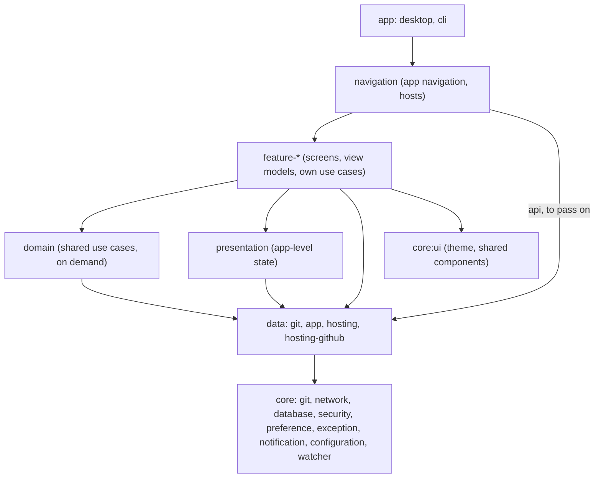

<!-- Generated from the Graft design notes by scripts/sync-design-docs.py. Edit the notes, not this file. -->

# 02 - Architecture

## Stack ([ADR-1](../03%20-%20Project/02%20-%20Decisions.md), [ADR-9](../03%20-%20Project/02%20-%20Decisions.md), [ADR-22](../03%20-%20Project/02%20-%20Decisions.md), [ADR-23](../03%20-%20Project/02%20-%20Decisions.md))

| Concern | Choice |
|---|---|
| Language | Kotlin (JVM 21) |
| UI | Compose Multiplatform Desktop + Camouflage with the Carbon skin in Atom One colors, themed in `:module:core:ui` ([UI Design](06%20-%20UI%20Design.md), [ADR-22](../03%20-%20Project/02%20-%20Decisions.md)) |
| Presentation | Sinew's ViewModel base (`sinew-viewmodel`, on AndroidX `lifecycle-viewmodel`): Event → Action → State + Effect ([ADR-23](../03%20-%20Project/02%20-%20Decisions.md)) |
| Errors | Sinew's `Result` + `SinewException` subclasses with Graft's codes ([ADR-23](../03%20-%20Project/02%20-%20Decisions.md)) |
| Network | `sinew-network` on the Ktor Java engine, configured in `:module:core:network`, plus Graft's ETag cache ([ADR-23](../03%20-%20Project/02%20-%20Decisions.md)) |
| Git | the `git` executable, `>= 2.38` ([Git Engine](03%20-%20Git%20Engine.md)) |
| Hosting APIs | Ktor client; GitHub GraphQL v4 + REST v3 |
| Local storage | SQLite (SQLDelight) for caches and app state; JSON for settings |
| Secrets | OS keychain: macOS Keychain, Windows Credential Manager, Linux Secret Service (libsecret) |
| Diff and syntax | a line diff from `git diff`; word diff computed in-app; syntax highlighting from TextMate grammars |
| DI | constructor injection, wired by hand in `:app:desktop` (Koin optional) |
| Packaging | Compose Gradle plugin (`jpackage`) or Conveyor: `.dmg`, `.msi`, `.deb`, `.rpm`, AppImage/Flatpak |

## Modules ([ADR-24](../03%20-%20Project/02%20-%20Decisions.md))

The shape is *Modular App with Navigation* from the author's architecture board, the same shape as Sinew's App Architecture.



| Module | Holds | Compose |
|---|---|---|
| `:app:desktop` | startup, hand-wired DI, the root Camouflage provider, the window shell, and the **app services** on Sinew's `AppService` / `AppServiceHost`: the repository session and watcher, background fetch, auto-snapshot, the inbox poller | yes |
| `:app:cli` | the `graft` CLI and `graft mcp`, a GraalVM native image ([CLI](../02%20-%20Features/31%20-%20CLI.md)) | **no** |
| `:module:navigation` | the app navigation on Navigation 3 ([ADR-26](../03%20-%20Project/02%20-%20Decisions.md)): back stacks per tab, `NavDisplay` with each feature's entries, and the **hosts** features contribute to: the main-window shell, the left panel, Settings, Search Everywhere, About. It receives the data modules `:app:desktop` built and passes each feature the `api` types it needs | yes |
| `:module:feature:home` | what isn't about one open repository: Home, workspaces, Clone, Init, Onboarding | yes |
| `:module:feature:graph`, `:module:feature:workingcopy`, `:module:feature:shelves`, `:module:feature:worktrees`, `:module:feature:submodules`, `:module:feature:changerequests`, `:module:feature:issues` | one area each: screens, their view models (`.presentation` package), the area's own use cases | yes |
| `:module:presentation` | app-level state, split by case: `WindowState` (tabs, active repository, its profile), `OperationsState` (background work for the status bar), `InboxState`, `ProviderState` (sign-in, rate limit) | no |
| `:module:domain` | use cases shared by two or more features; created when the first one is shared | no |
| `:module:data:git` | git-backed repositories (commits, refs, working copy, stash, shelves, local history, changelists, worktrees, submodules, sync), their models (`CommitRow`, `Ref`, `ObjectId`, …), and the git commands and parsers they read through `GitRunner` (internal) | no |
| `:module:data:app` | profiles, settings, repositories and workspaces | no |
| `:module:data:hosting` | provider-neutral repository interfaces and models (`ChangeRequest`, `Issue`, `Pipeline`, `Account`, `Notification`) and the contract test kit ([Provider Model](04%20-%20Provider%20Model.md)) | no |
| `:module:data:hosting-github` | the GitHub implementation and its API source | no |
| `:module:core:ui` | the theme (Carbon skin, Atom One colors, IBM Plex Sans, 24/32 px density), Graft-only shared components (diff viewer, ref chips, avatars), stopgap components until Camouflage ships them, the `Localizer` | yes |
| `:module:core:git` | `GitRunner`: the configured git process runner, its environment, the write queue, and the `GitException` family | no |
| `:module:core:network` | the configured HTTP client on `sinew-network`, the token source, the ETag cache | no |
| `:module:core:database` | the SQLDelight cache | no |
| `:module:core:security` | `SecretStore` on the OS keychain | no |
| `:module:core:preference` | versioned settings files, atomic writes | no |
| `:module:core:exception` | the error-code registry and text redaction, shared by every module; each module's own `SinewException` subclasses live with the code that raises them (git's in `:module:core:git`) | no |
| `:module:core:notification` | desktop notifications | no |
| `:module:core:configuration` | app folders and platform paths | no |
| `:module:core:watcher` | `FileWatcher` on `directory-watcher`, used only by `:app:desktop`'s repository session ([Platform Integration](../04%20-%20Development/08%20-%20Platform%20Integration.md)) | no |

Rules:
- Dependencies point down only. Features never import each other; navigation imports features, never the reverse, and the data modules' `api`, to pass them on.
- `:module:data:*` never imports `:module:feature:*`, `:module:presentation`, `:module:domain` or `:module:core:ui`; `:module:core:*` never imports a business module.
- Compose only in `:module:core:ui`, `:module:feature:*`, `:module:navigation` and `:app:desktop`. `:app:cli` never depends on them; it talks to a running app over a local socket.
- Camouflage (`com.srctool.camouflage`) is used only where Compose is; nothing imports `androidx.compose.material3` ([ADR-22](../03%20-%20Project/02%20-%20Decisions.md)).
- Only `:module:data:hosting-github` says "GitHub" ([ADR-4](../03%20-%20Project/02%20-%20Decisions.md)).
- **Models live in the data or domain module that needs them**, never in `:module:core`. A model two data modules need moves to `:module:domain`, or each keeps its own and maps.
- **Every data module has the same packages** (`com.srctool.graft.data.<name>.…`). Only `api` and `di` are public; other modules reach a data module through its `di` wiring and use only its `api`. `checkImports` fails on a `public` declaration anywhere else.

  ```
  api
    models          the Domain models
    repositories    the repository interfaces
  di                wiring: builds the implementations behind the api interfaces
  implementation    internal
    repositories    the repository implementations
    source
      local         local sources (the git commands and parsers, the database)
        entity      stored rows
      remote        remote sources
        response    response DTOs
        request     request DTOs
        api         the API client calls
  ```
- **Every feature module has the same packages** (`com.srctool.graft.feature.<name>.…`). `domain` is pure Kotlin with no Compose, so it's tested without a UI, and it's shaped like a data module without `di`; logic a second feature needs moves to `:module:domain`.

  ```
  presentation
    <screen>          one screen, one file each:
                        <Screen>Page          the page: renders State, sends Events, handles Effects
                        <Screen>ViewModel     Sinew's EventActionViewModel: Event → Action → State + Effect
                        <Screen>State, <Screen>Event, <Screen>Action, <Screen>Effect
                        <Screen>Navigation    the route with its arguments, and the destination that builds
                                              the view model from them and its dependencies and connects it
                                              to the page (the screen's coordinator)
    components        components only this feature uses
  domain
    api
      models          the feature's models (the graph's GraphRow)
      usecases        use-case and pure-logic interfaces (GraphLayout)
    implementation
      usecases        their implementations (LaneLayout); the navigation file wires them
  ```
- The allowed edges are listed in `config/module-graph.txt`; CI fails any other.

## Layers

| Layer | Error code | Holds | Example |
|---|---|---|---|
| Source | `R` | a configured instance that reaches git, the network or a store | `GitRunner.run(LogCommand(...))` |
| Repository | `R` | data access and mapping, no branching logic | `CommitRepository.log()`, `ShelfRepository.shelve(selection)` |
| Use case (only when there's orchestration) | `UC` | multi-step flows, safety steps, retry and polling | `ShelveUseCase`, `PushUseCase` (guards, then push) |
| App service (app or session lifetime) | `SV` | work triggered by the watcher, timers or the inbox; Sinew's `AppService`, started by `AppServiceHost` in `:app:desktop` (Sinew 1.1) | `RepositorySession`, background fetch |
| View model | `VM` | folds `Result`s into state and effects, no `try`/`catch` | `GraphViewModel` |
| UI | | Compose screens from Camouflage and `:module:core:ui` | `GraphPane` |

**Build order** ([ADR-24](../03%20-%20Project/02%20-%20Decisions.md)): within each milestone, tasks go bottom to top: `:module:core` → `:module:data` → use cases → `:module:presentation` → feature UI → `:module:navigation` / `:app`. The author reviews each layer before the next is built on it.

## Repository session

Opening a repository creates a `RepositorySession`:
- the repositories of `:module:data:git` for that folder, and one file watcher on `.git/` and the working tree (an app service in `:app:desktop`);
- a **write queue**: Git mutations run one at a time per repository (Git holds `index.lock` anyway), reads run in parallel;
- a `StateFlow<RepoSnapshot>` (HEAD, refs, status, operation in progress) every pane observes.

Each worktree and each opened submodule is its own session. They share the object store, so caches keyed by commit hash are shared.

## Threading

- UI on the Compose main thread only.
- `git` processes on `Dispatchers.IO`, with a cap per repository (default 4 readers).
- Parsing streams line by line, so the first graph rows render before `git log` finishes.
- Every operation is cancellable: cancelling kills the process tree.

## Refresh

| Trigger | Refresh |
|---|---|
| Change in `.git/HEAD`, `.git/refs/**`, `packed-refs` | refs, graph decorations |
| Change in `.git/index` or working tree | status (debounced 300 ms) |
| `.git/MERGE_HEAD`, `rebase-merge/`, `CHERRY_PICK_HEAD` appear | operation banner |
| Window gains focus | everything that is stale |
| Timer (default 5 min, off on battery) | background `fetch --prune` |

## Error model

Every failure is a `SinewException` with a code `module-layer-function-type`, for example `GIT-R-PUSH-REJ` (push rejected, non-fast-forward), and every fallible call returns Sinew's `Result` ([ADR-23](../03%20-%20Project/02%20-%20Decisions.md)). Git failures are the `GitException` subclasses in `:module:core:git` and keep argv, exit code and redacted stderr. Messages are `ErrorMessage.Local` keys with an English fallback, rendered by the `Localizer`; the UI shows the message, the code and a "Show output" button.

## Storage locations

| What | Where |
|---|---|
| App settings, window state, recent repos | OS app data dir (`~/Library/Application Support/Graft`, `%APPDATA%\Graft`, `$XDG_CONFIG_HOME/graft`) |
| Cache (provider data, graph layout) | OS cache dir; safe to delete |
| Profiles (identity, rules, workspace, preferences) | app data dir `profiles/<id>/` |
| Tokens, SSH passphrases | OS keychain only |
| Managed SSH keys | `~/.ssh/graft_<profile>_ed25519` (so the terminal can use them too) |
| Shelves | inside the repository, as refs `refs/graft/shelves/*` ([Shelves](../02%20-%20Features/06%20-%20Shelves.md)) |
| Local history snapshots | refs `refs/graft/history/<worktree-id>` ([Local History](../02%20-%20Features/14%20-%20Local%20History.md)) |
| History-rewrite backups | refs `refs/graft/backup/<timestamp>/*` |
| Changelists | `$GIT_DIR/graft/changelists.json`, per worktree ([Changelists](../02%20-%20Features/15%20-%20Changelists.md)) |
| Stack parents | git config `branch.<name>.graftParent` ([Stacked Branches](../02%20-%20Features/25%20-%20Stacked%20Branches.md)) |
| Commit-guard exceptions | `$GIT_DIR/graft/guard-allow.json` (local) or `.graft/guard.toml` (committed, optional) |
| Per-repo UI state (hidden branches, pinned) | `$GIT_COMMON_DIR/graft/state.json` |
