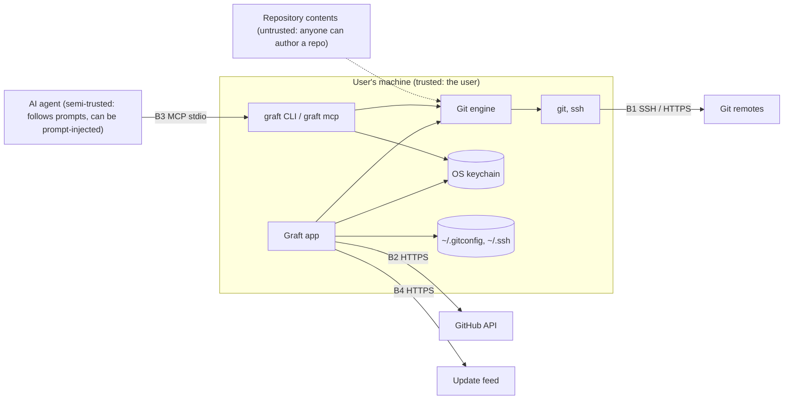

<!-- Generated from the Graft design notes by scripts/sync-design-docs.py. Edit the notes, not this file. -->

# 07 - Threat Model

Graft holds GitHub tokens and SSH keys, runs `git` on repositories cloned from strangers, edits `~/.gitconfig`, and gives AI agents tools through MCP. This note lists what could go wrong and what Graft does about it, using STRIDE per trust boundary. It's reviewed at every milestone that adds a boundary (G3, G6, G9).

## What we protect

| Asset | Why it matters |
|---|---|
| Provider tokens (GitHub) | full access to the user's repos and orgs |
| SSH private keys and passphrases | push access everywhere the key is registered |
| Uncommitted work, shelves, local history | can't be recovered from anywhere else |
| Commit identity and signing keys | commits can be attributed to the wrong person, or forged |
| `~/.gitconfig`, `~/.ssh/config`, `known_hosts` | shared with every other tool on the machine |
| The user's machine | Graft runs processes with the user's rights |

## Data flow and trust boundaries

| Boundary | Between |
|---|---|
| **B0** | Graft ↔ repository contents (files, config, hooks, submodules, commit messages) |
| **B1** | git/ssh ↔ remotes |
| **B2** | Graft ↔ GitHub API |
| **B3** | AI agent ↔ `graft mcp` / `graft` CLI |
| **B4** | Graft ↔ update feed and package channels |

## Threats and mitigations

| # | Boundary | STRIDE | Threat | Mitigation |
|---|---|---|---|---|
| T1 | B0 | Elevation | A cloned repo runs code: hooks, `core.fsmonitor`, `core.sshCommand`, filter drivers in a repo's config | Git never takes hooks or config from a clone; Graft never writes repo-supplied config into `.git/config`; `.gitattributes` filter drivers need the user's own config. Graft shows active hooks before the first commit in a newly cloned repo |
| T2 | B0 | Elevation | Malicious submodule URL (`ext::`, `file://`, option injection like `-u…`) | rely on Git's `protocol.allow` defaults (`ext` blocked); Graft passes URLs after `--`; submodule URLs are shown before init |
| T3 | B0 | Tampering | Crafted file names or ref names: terminal escapes, `..` paths, names starting with `-` | argv only, never a shell; `--` before paths; names rendered as text with control characters escaped; `git check-ref-format` before creating refs |
| T4 | B0 | DoS | Huge repos, zip-bomb blobs, enormous diffs | streaming parsers; diff size limits (2 MB inline); per-operation cancel |
| T5 | B0 | Spoofing | Markdown in PRs, issues or commits with links that look safe, or images that track | Markdown rendered without raw HTML; real link targets shown on hover; remote images opt-in |
| T6 | B1 | Spoofing | Man in the middle on first SSH connection | host keys checked against the provider's published fingerprints; mismatch is refused; never `StrictHostKeyChecking=no` ([SSH](../02%20-%20Features/12%20-%20SSH.md)) |
| T7 | B1 | Info disclosure | Credentials in remote URLs (`https://user:token@…`) | flagged in the remotes panel with "move to keychain"; redacted in logs |
| T8 | B2 | Info disclosure | Token leaks via logs, crash reports, exceptions, fixtures | redaction at write time; crash reports opt-in and redacted; fixture scanner in CI ([Conventions](../04%20-%20Development/02%20-%20Conventions.md)) |
| T9 | B2 | Elevation | Token with more scopes than needed | device flow asks minimal scopes; `write:public_key` and others only when a feature needs them, at that moment |
| T10 | B2 | Spoofing | `graft credential` gives a token to the wrong host | the helper answers only for the exact host the token belongs to; HTTPS only |
| T11 | B3 | Elevation | A prompt-injected agent uses Graft to do damage (restore over files, drop shelves, exfiltrate) | MCP tools exclude profiles, config, tokens, push, force and history rewriting; destructive tools carry `destructiveHint` and need `confirm`; snapshots before restores ([MCP Server](../02%20-%20Features/32%20-%20MCP%20Server.md)) |
| T12 | B3 | Info disclosure | An agent reads secrets through Graft tools | no tool returns tokens; guard findings are masked; local history content is returned only for files inside the repo |
| T13 | B3 | Tampering | Another local process talks to the app's socket | socket in a user-only directory (mode 0700 / per-user named pipe ACL); requests carry a per-session token from a user-only file |
| T14 | Machine | Tampering | Graft corrupts `~/.gitconfig` | edits only inside its marked block; atomic write; backup before the first edit; shows the diff once ([Terminal and AI Agents](../02%20-%20Features/13%20-%20Terminal%20and%20AI%20Agents.md)) |
| T15 | Machine | Repudiation | "Who changed my branch?" | op log with argv and ref before/after; reflog timeline labels the source ([Reflog and Recovery](../02%20-%20Features/16%20-%20Reflog%20and%20Recovery.md)) |
| T16 | Machine | Info disclosure | Snapshots or shelves keep a secret the user deleted | local only, never pushed; retention; "purge from local history" action for a file |
| T17 | B4 | Tampering | Malicious update | signed artifacts and appcast; signature verified before install; keys only in release CI ([Release and Updates](../04%20-%20Development/05%20-%20Release%20and%20Updates.md)) |
| T18 | B4 | Tampering | Compromised dependency (supply chain) | version catalog with pinned versions; Gradle dependency verification metadata; SBOM; license and vulnerability checks nightly |

## Privacy

The full list of requests is in [Privacy](../03%20-%20Project/07%20-%20Privacy.md).

- No telemetry. Crash reports are opt-in, redacted, and previewable before sending.
- The update check sends only the version and OS.
- Avatars come from the provider or Gravatar; they can be turned off.
- AI features never send code anywhere by themselves. Agents are the user's own tools.

## Reporting

`SECURITY.md`: private reporting through GitHub Security Advisories, acknowledgement within 7 days, and a fix or mitigation plan within 30 days for high severity.

## Open questions

- [ ] Should Graft warn before opening a repo whose `.gitmodules` points to non-HTTPS/SSH URLs?
- [ ] Rate-limit destructive MCP tools per session?
