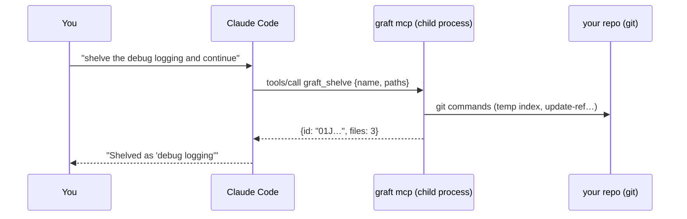

<!-- Generated from the Graft design notes by scripts/sync-design-docs.py. Edit the notes, not this file. -->

# 32 - MCP Server

`graft mcp` lets AI agents (Claude Code, Cursor, others) use Graft's features as tools, without being taught the [CLI](31%20-%20CLI.md).

## What MCP is, in short

**MCP (Model Context Protocol)** is a standard way for an AI app to discover and call tools that another program offers. The AI app is the *client*; the program offering tools is the *server*.

Despite the name, a "server" here is **not something you deploy**. There are two kinds:

| Kind | Runs where | Transport | Example |
|---|---|---|---|
| **Local (stdio)** | on your machine; the AI app starts it as a child process and talks over stdin/stdout | stdio | **`graft mcp`** |
| Remote (HTTP) | on a server somewhere, reached over the network | HTTP | hosted services (GitHub's, Linear's) |

`graft mcp` is **local only**: no VPS, no port, no login. It has to be local anyway, because it works on your repositories, your Git and your keychain. When Claude Code starts, it launches `graft mcp` in the background; when Claude Code exits, it stops.



## Distribution

There's no separate MCP download: `graft mcp` is a subcommand of the `graft` CLI. People get it in one of three ways:

| Way | Who it's for | What they install | Then |
|---|---|---|---|
| **1. With the app** (default) | most users | the Graft installer (dmg, msi, deb/rpm, AppImage, Flatpak), Homebrew cask, winget | Onboarding puts `graft` on `PATH` and offers to register the MCP server |
| **2. CLI only** | people who want the agent tools without the desktop app; CI | the `graft-cli` package | register the MCP server by hand (see Setup) |
| **3. Claude Code plugin** | Claude Code users who want everything in one step | the Graft app or `graft-cli` first, then the plugin | nothing else: the plugin registers the server and the hooks |

### 1. Bundled with the app

- Every app installer contains the `graft` native binary, at the same version as the app.
- Updating the app updates the CLI and the MCP server together, so their versions never drift apart.

### 2. CLI-only package: `graft-cli`

- **Channels:** Homebrew formula `graft-cli`, winget `Graft.CLI`, Scoop, AUR, and plain archives per OS and architecture on GitHub Releases (checksummed and signed).
- **Works without the app:** shelves, changelists, local history, guards, stacks, `whoami`, `doctor`, and `graft mcp`.
- **Needs the app:** creating and editing profiles (the CLI never changes profiles, ADR-19) and writing review comments. Without profiles, the repo simply uses your plain git config; `graft whoami` still reports what applies.
- **In CI:** `graft guard --range origin/main..HEAD` as a pipeline step blocks secrets in PRs, with no app involved.

### 3. Claude Code plugin

A `graft` plugin, published from the Graft repository's own plugin marketplace. It bundles:

| Part | Effect |
|---|---|
| MCP server entry | runs `graft mcp`, so no `claude mcp add` step |
| Hook: before file edits (`PreToolUse` on Edit/Write tools) | `graft snapshot --quiet` → a [Local History](14%20-%20Local%20History.md) snapshot before every agent edit |
| Hook: before `git commit` / `git push` commands | `graft guard` → [Commit Guards](19%20-%20Commit%20Guards.md) for the agent's own commits and pushes |
| Instructions (skill) | when to use Graft's tools: shelve instead of `git stash`, read review feedback, check `graft whoami` before committing |

Install, inside Claude Code:

```
/plugin marketplace add srctool/graft
/plugin install graft@graft
```

- **The plugin still needs the `graft` binary.** Its hooks check for `graft` once per session; if it's missing, they print one install hint and do nothing, instead of failing on every edit.
- **Versions:** the plugin declares the minimum `graft` version it needs. `graft mcp` reports its version when Claude Code connects, and too-old binaries get an "update Graft" message.

### Other agents

- **Cursor:** an "Add to Cursor" install button on the docs site (Cursor's MCP install link), or the `mcp.json` snippet below.
- **Other MCP clients:** the same generic stdio entry: command `graft`, args `["mcp"]`.

## Setup

Once, per AI tool (Onboarding step 8 offers to do it and shows the change first):

**Claude Code** (for all your projects):

```bash
claude mcp add --scope user graft -- graft mcp
```

Or `--scope project` to write it into the repo's `.mcp.json`, so teammates who have Graft get it too.

**Cursor**: `~/.cursor/mcp.json` (all projects) or `.cursor/mcp.json` (one repo):

```json
{ "mcpServers": { "graft": { "command": "graft", "args": ["mcp"] } } }
```

The Graft app doesn't need to be open. If it is, it shows the agent's changes immediately.

## Tools

Each tool maps to a CLI command and returns JSON. The repository is the client's working folder (MCP "roots").

| Tool | Does | Marked |
|---|---|---|
| `graft_whoami`, `graft_doctor` | profile and checks for this repo | read-only |
| `graft_guard` | check staged changes or a range before committing/pushing | read-only |
| `graft_shelf_list`, `graft_shelf_show` | list and inspect shelves | read-only |
| `graft_shelve` | shelve paths (or all) with a name | writes |
| `graft_unshelve` | restore a shelf (all or paths) | writes |
| `graft_changelist_list`, `graft_changelist_new`, `graft_changelist_move`, `graft_changelist_active` | manage changelists | writes (except list) |
| `graft_changelist_commit` | commit one changelist | writes |
| `graft_snapshot` | take a local history snapshot | writes |
| `graft_history_list`, `graft_history_deleted` | snapshots, deleted files | read-only |
| `graft_history_restore` | restore a file from a snapshot | **destructive** |
| `graft_review_feedback`, `graft_review_resolve` | read your review comments; mark them handled | read / writes |
| `graft_stack_show`, `graft_stack_branch`, `graft_stack_restack` | stacked branches | read / writes |
| `graft_compare` | summary of A vs B (commits, files, merge preview) | read-only |
| `graft_my_work` | your review requests, PRs and issues | read-only |

- **Safety annotations.** Each tool carries MCP's hints (`readOnlyHint`, `destructiveHint`). Claude Code and Cursor use them to ask you before running a destructive tool.
- **Resources** (read-only context the agent can pull): `graft://repo/profile` and `graft://review/feedback`.

## What it deliberately doesn't offer

The same rule as the CLI: no tool changes profiles or git config, reveals tokens, force-pushes, deletes branches or rewrites history. Agents still have `git` for ordinary work; Graft adds only the things `git` can't do.

## Example uses

- "Shelve what you have, fix the bug on main, then bring it back": `graft_shelve` → work → `graft_unshelve`.
- After you review in Graft: "address my review comments": `graft_review_feedback` → edits → `graft_review_resolve`.
- "I broke `Login.kt`, get the version from 20 minutes ago": `graft_history_list` → `graft_history_restore` (Claude Code asks you first).
- "Split this into a stack": `graft_stack_branch` per part, then you push and submit the stack from Graft (pushing stays with you).

## Edge cases

| Case | Decided behavior |
|---|---|
| Client's folder isn't a repo | tools return a clear "not a Git repository" error |
| Two agents call tools on one repo at once | the per-repo write queue serializes them ([ADR-3](../03%20-%20Project/02%20-%20Decisions.md)) |
| Guard blocks a commit | the tool returns the findings (secret masked) so the agent can fix them |
| Old client without tool annotations | destructive tools require a `confirm: true` argument |
