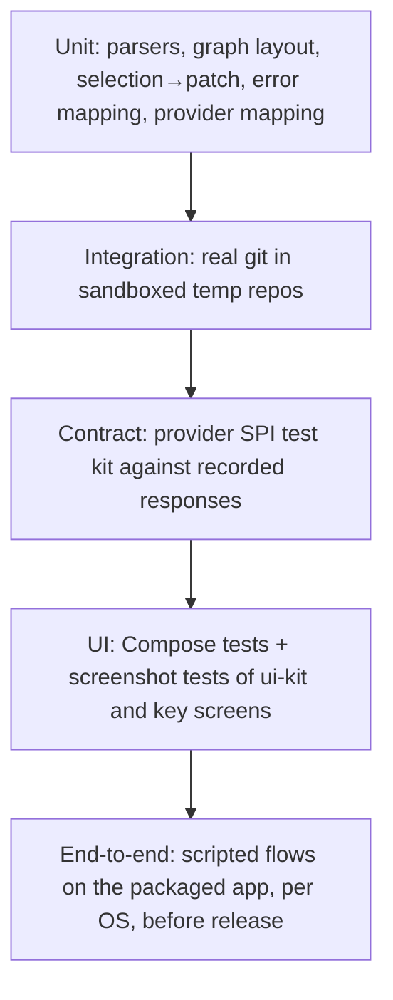

<!-- Generated from the Graft design notes by scripts/sync-design-docs.py. Edit the notes, not this file. -->

# 03 - Testing Strategy

## 1. Why

Graft runs real `git` against people's real work, and it writes `~/.gitconfig`, `~/.ssh` and the keychain on purpose. The risks are losing someone's changes, committing as the wrong identity, and leaking a token. The tests are shaped around those risks, not around a coverage number.

## 2. Shape



| Level | What | How many |
|---|---|---|
| **Unit** | pure logic: parsers, lane layout, patch building, retention thinning, rule matching, error codes | most tests; milliseconds each |
| **Integration** | every git command and every feature service against real `git` in temp repos | one or more per command and per edge case in the notes |
| **Contract** | `core-provider-testkit`: one suite every provider must pass, with recorded HTTP | per provider |
| **UI** | Compose UI tests (semantics, keyboard), screenshot (golden) tests for `ui-kit` and the main screens, light and dark | per component and screen |
| **End-to-end** | a few scripted user flows on the packaged app | per release |
| **Performance** | graph layout and rendering benchmarks, status on a large repo | in CI on Ubuntu, nightly |

## 3. API

### 3.1 The sandbox (`GitSandbox`)

Every test that runs git, SSH or config code gets a `GitSandbox` (a JUnit 5 extension in `core-git`'s test fixtures). It sets up:

| Variable / fake | Value |
|---|---|
| `HOME`, `XDG_CONFIG_HOME`, `APPDATA` | temp directories |
| `GIT_CONFIG_GLOBAL` | a temp file |
| `GIT_CONFIG_NOSYSTEM` | `1` |
| `GIT_AUTHOR_*` / `GIT_COMMITTER_*` | fixed name, email and dates, for reproducible hashes |
| `SSH_AUTH_SOCK` | unset; SSH tests use a temp `sshd` or a fake `ssh` script |
| Keychain | `InMemorySecretStore` |
| Clock | an injectable `Clock`; no `System.currentTimeMillis()` in code under test |

**Never** run git from a test against the working directory, the Graft repository, or `~`. A guard in the sandbox fails the test if any process starts outside the sandbox root.

### 3.2 Repository builders

A small DSL builds repositories for tests:

```kotlin
val repo = sandbox.repo {
    commit("init") { file("a.txt", "1") }
    branch("feature") { commit("f1") { file("b.txt", "x") } }
    commit("main 2") { file("a.txt", "2") }
    merge("feature")
    worktree("../wt", branch = "hotfix")
    submodule("lib") { commit("lib init") }
}
```

### 3.3 Fixtures

| Fixture | Where | Rule |
|---|---|---|
| Recorded git output | `fixtures/git/<command>/<case>.bin` | raw bytes (`-z` output), including non-UTF-8 paths and messages, renames, binaries, submodules |
| Recorded HTTP | `fixtures/github/<scenario>/*.json` | recorded once from a test account, then **scrubbed** (tokens, emails, node ids replaced); a test fails if a fixture contains a token pattern |
| Big repo | not committed; downloaded by the benchmark job | a treeless clone of a 500k+ commit public repo |

### 3.4 What each risky area must test

| Area | Must cover |
|---|---|
| Shelves, local history, changelists | round trip (shelve → unshelve) gives byte-identical files; binaries; renames; untracked files; three-way unshelve after the branch moved; the index is never changed by shelving |
| Discard, clean, reset, history rewriting | a snapshot or backup exists before the operation; undo restores exactly |
| Profiles | identity resolution for path rules, remote rules and pinned repos; `~/.gitconfig` block written only inside markers; existing user content preserved byte for byte |
| SSH | host-key mismatch is refused; `BatchMode` fails fast; key files never overwritten |
| Commit guards | every token pattern detected; masked in output; allowlist by fingerprint |
| Credentials | `graft credential` returns only the matching host's token; nothing written to disk |
| Concurrency | two writes on one repo are serialized; a write during a long read; cancellation kills the process tree |

### 3.5 Git versions and OSes

- Integration tests run on **Git 2.38** (the minimum) and the **latest** release.
- All tests run on macOS, Windows and Linux in CI ([CI](04%20-%20CI.md)).
- One CI job runs from a folder whose path contains spaces and non-ASCII characters.

## 4. Build steps

1. `GitSandbox` and the repository DSL (G0 Task 5).
2. Parser fixtures with each new command.
3. `core-provider-testkit` with the first provider (G6).
4. Screenshot tests for `ui-kit` from G1; goldens are updated only on purpose (`-PupdateGoldens`).
5. End-to-end flows before G7: clone → branch → commit → shelve → push → PR → merge.

## 5. Edge cases

| Case | Decided behavior |
|---|---|
| A test is flaky | quarantined with an issue the same day; never retried silently in CI |
| Screenshot differs between OSes (font rendering) | goldens are recorded on Linux only, with a bundled font |
| Time-dependent logic (retention, snooze) | uses the injected `Clock`, never real time |
| Network in unit tests | blocked; the HTTP client is a recorded-response fake |
