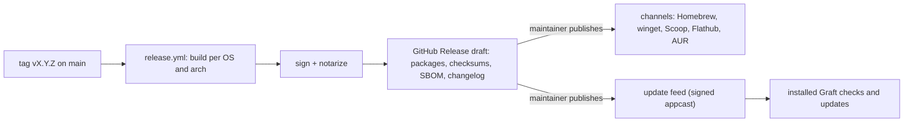

<!-- Generated from the Graft design notes by scripts/sync-design-docs.py. Edit the notes, not this file. -->

# 05 - Release and Updates

## 1. Why

A Git client is trusted with every repository on the machine, so its builds must be verifiable and its updates safe. A broken update that corrupts shelves or local history is worse than no update.

## 2. Shape

## 3. API

### 3.1 Versions

- **SemVer** for the app, the CLI and the Claude Code plugin, all released together at one version.
- **Channels:** `stable` and `beta` (pre-release tags `vX.Y.Z-beta.N`). The user picks a channel in Settings.
- **Storage format versions** are separate from the app version ([Storage Formats](06%20-%20Storage%20Formats.md)).

### 3.2 Artifacts per release

| OS | App | CLI |
|---|---|---|
| macOS (arm64, x64) | signed + notarized `.dmg` | `graft` native binary in the app bundle; archive for `graft-cli` |
| Windows (x64, arm64) | signed `.msi` | `graft.exe` |
| Linux (x64, arm64) | `.deb`, `.rpm`, AppImage; Flatpak via Flathub | `graft` |

Plus `SHA256SUMS` (signed), a CycloneDX SBOM, and the changelog generated from Conventional Commits.

### 3.3 Signing

| OS | How |
|---|---|
| macOS | Developer ID certificate + notarization (needs the paid Apple Developer account). Until then, unsigned builds with "right-click → Open" in the install docs |
| Windows | SignPath Foundation (free for open source) or an OV certificate |
| Linux | `SHA256SUMS` signed with the project's GPG key; Flathub signs its own builds |

Keys live only in GitHub environment secrets with required reviewers, and are used only by `release.yml` on tags ([CI](04%20-%20CI.md)).

### 3.4 Auto-update

| Topic | Decision |
|---|---|
| Mechanism | Conveyor's update system, or Sparkle (macOS) / WinSparkle (Windows) with a signed appcast; Linux updates through the package manager or Flathub |
| Check | on start and every 24 h; the feed request sends no identifiers beyond the version and OS |
| Install | downloads in the background; installs on quit or on "Restart now"; never while a git operation is running |
| Verification | the update's signature is checked before installing; a failed check discards it |
| Rollback | the previous version is kept until the new one starts cleanly once |
| Off switch | Settings → Updates → "Check automatically" (also off for package-manager installs) |

## 4. Build steps

1. `release.yml` producing unsigned artifacts and a draft release (G7).
2. Windows signing via SignPath; Linux checksums signed (G7).
3. macOS notarization once the Apple account exists (G8).
4. Auto-update with a beta channel first (G8).

## 5. Edge cases

| Case | Decided behavior |
|---|---|
| New version needs a newer storage format | migration runs at first start, after a backup ([Storage Formats](06%20-%20Storage%20Formats.md)) |
| User downgrades | the older app refuses to write newer-format data and says which version is needed; it can still read refs |
| Update while agents use `graft mcp` | the CLI binary is replaced atomically; running MCP processes keep the old binary until the agent restarts them |
| Corporate machine without admin rights | per-user install locations on Windows and macOS |
